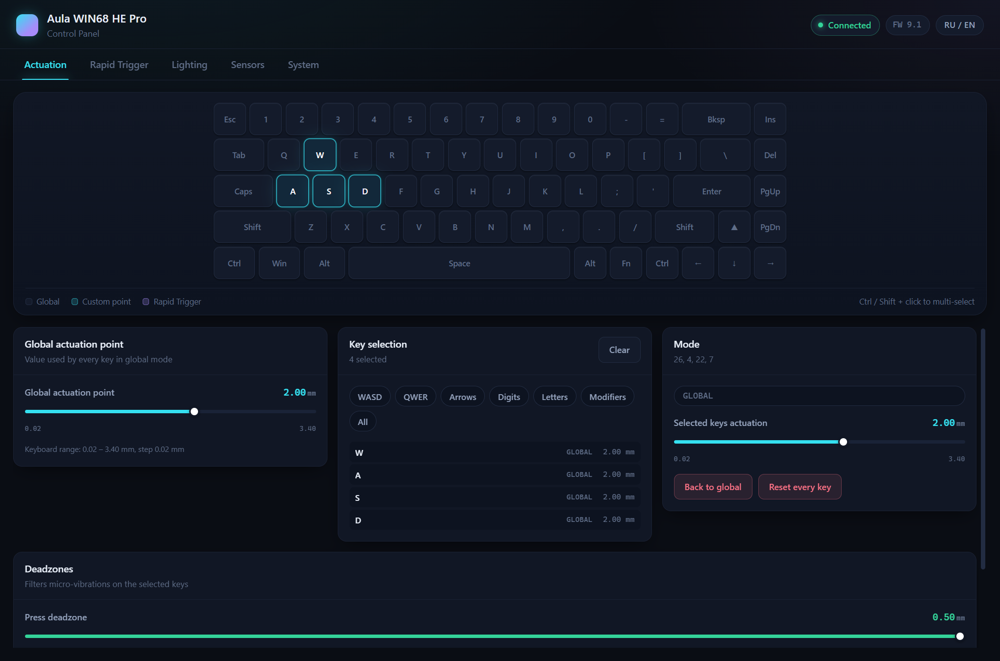
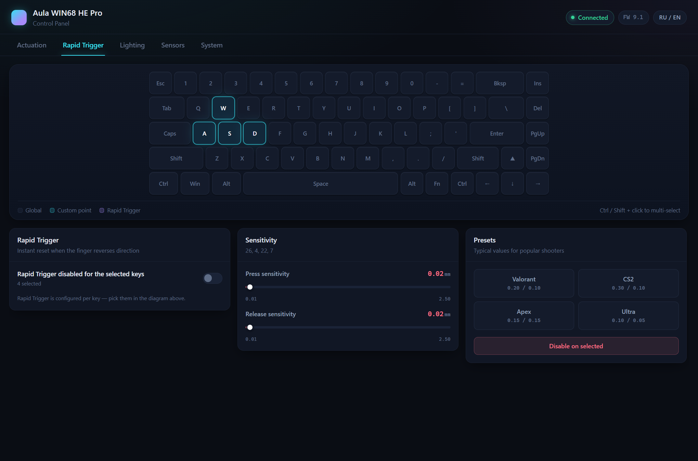
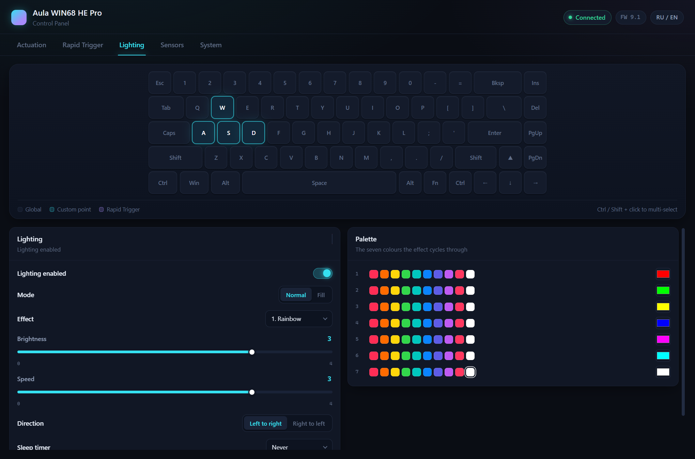
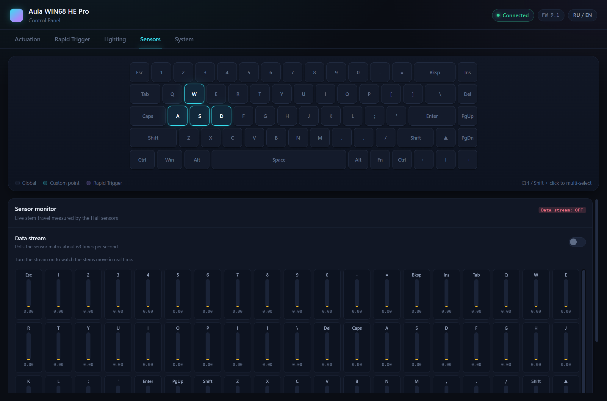
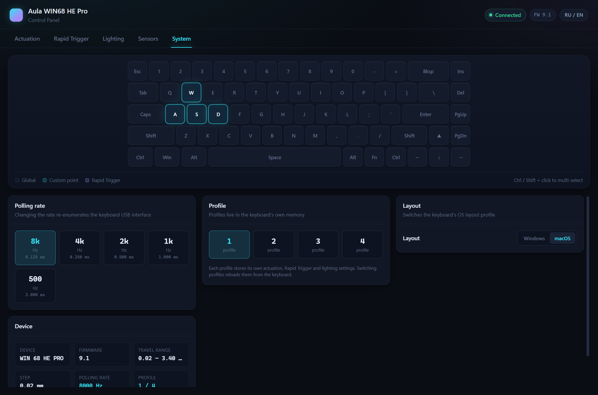

# Aula WIN68 HE Pro — Control Panel

A native desktop control panel for the **Aula WIN68 HE Pro** magnetic keyboard.
Rust + Tauri v2 on the back end, Preact on the front, direct HID access on the
vendor interface. No browser, no driver, no internet required.

[English](README.md) · [Русский](README.ru.md)

> **Not affiliated with Aula or Aulastar.** This is an independent,
> community-driven tool built by reverse engineering the keyboard's USB protocol
> so people are not forced into a browser-based driver to adjust their keyboard.

---

## Why this exists

The vendor control panel is a web page. It works, but it is slow, it asks the
browser for HID permission every session, and it hides the hardware behind
presets. If you want to type, move a slider and see the millimetres, you should
not have to reload a tab.

This app is a 3.2 MB executable that starts instantly, talks to the keyboard
directly, and shows you the numbers the firmware actually reports.

---

## What works

Everything below was verified by writing to a real WIN68 HE Pro and reading the
value back. See [docs/PROTOCOL.md](docs/PROTOCOL.md) for the byte-level details
and [docs/RESEARCH-NOTES.md](docs/RESEARCH-NOTES.md) for the full feature
matrix including what does **not** work.

| Section | |
|---|---|
| **Actuation** | Global actuation point bounded by the range the keyboard itself reports. Individual points for selected keys. Reset to global for the selection or for all 68 keys at once. Per-key press/release deadzones. |
| **Rapid Trigger** | Enable RT on selected keys, tune press and release sensitivity separately, presets for Valorant / CS2 / Apex / ultra-fast. |
| **Snap Tap** | Bind two keys and pick the resolver: last-pressed-wins, first-key, second-key, or neutral. Semantics captured from the vendor's own driver, behaviour confirmed on the board. |
| **Mod-Tap** | A hold output and a tap output on any key, hold threshold in 10 ms steps, whole-board scan for existing assignments. |
| **Lighting** | 21 effects, brightness, speed, direction, sleep timer, Super Response, and a 7-colour palette with quick swatches and a full colour picker. |
| **Sensors** | **Monitor** and **Recording & osu!** sub-tabs: 68 real-time Hall-sensor gauges with peak hold, keystroke practice, opt-in Windows Raw Input recording, and optional tosu integration. |
| **System** | Polling rate 500–8000 Hz with the latency for each step, 4 on-keyboard profiles, Windows/macOS layout switching, full device readout, and configuration export/import to a file. |

In **Sensors → Recording & osu!**, opt-in Z/X practice recordings on Windows can
include observed osu! statistics from a separately running
[tosu](https://github.com/tosuapp/tosu) instance. Recording stops sensor polling by default;
travel graphs are optional. This reduces application work, but the effect on
game performance depends on the computer. In **Compare attempts**, pin the current
recording as a baseline before recording another, or load a previously exported
JSON. The baseline summary and current recording stay in memory when changing
tabs, until the app closes; export JSON before the next recording to keep the
complete baseline. Key travel on the keyboard diagram and the Sensors tab share
one stream switch; leaving the tab does not stop it, while disconnecting or
re-enumerating stops the backend stream, and an active tosu connection remains
open. The view checks available
map and mod identifiers and shows median key-hold durations and last observed
game statistics. These observations include time outside gameplay, may have
missing samples and are not automatically attributed to a key or setting.
During recording, the optional tosu K1/K2 stream stores sampled game-side
counters next to Windows Z/X events. Different devices, mappings, timing and
counter resets can cause differences; this does not identify a lost press.

The Rapid Trigger tuning guide collects three attempts for each of two settings
on Z or X, with comfort and self-reported symptoms. It checks available Z/X
settings, map, mods and passage timing; matching those does not prove identical
gameplay. Summaries and ratings are stored locally between app launches; full
recordings require a separate JSON export. The guide never writes keyboard
settings or determines an optimal value.
The guide can reload a saved JSON recording that contains detailed settings.

Key selection is shared across every key-oriented tab (Actuation, Rapid Trigger,
Snap Tap, Mod-Tap, Sensors): click or drag across keys to select them,
`Ctrl`/`Shift`+click to add to the selection, and the chips give you WASD, QWER,
arrows, digits, letters, modifiers or everything (or quick pairs on Snap Tap).
The diagram marks Snap Tap (`ST`) and Mod-Tap (`MT`) assignments and hides on
Lighting and System. Interface is RU/EN.

## Status of the features people expect

The authoritative protocol reference turned out to be the **vendor's own public
driver JavaScript**, not the firmware. See
[`docs/VENDOR-DRIVER.md`](docs/VENDOR-DRIVER.md). Recovering it corrected several
conclusions this project had published, so read that file before trusting the
list below.

Correctly **absent from the UI**:

* **Calibration and factory reset** — the commands do not exist. The old code
  pointed at 12/13, which are *bootloader* commands (`BL_WRITE`/`BL_READ`); the
  vendor's own enum has the same collision with
  `START_ADJUSTING`/`SAVE_ADJUSTING`. That is why those buttons never did
  anything.
* **Logo / ambient lighting** (command 25) — rejected with `0xFF`.
* **Global deadzones** — the fields in command 41 read back as zero.
* **Rapid Switch (45)** — never send this one. It answers with a valid-looking
  frame but persists nothing, and a write **corrupts the mode of five keys**.
  See [`docs/VENDOR-DRIVER.md` §6](docs/VENDOR-DRIVER.md).

**Snap Tap (44) works end to end** — and it took a capture session to prove it.
The resolver mode travels in payload byte 8 (the parameter the vendor bundle
names `type`), while byte 7 stays zero; every earlier attempt in this repo
wrote the mode one byte to the left, which is why the pair stored but never
switched. Two guessed configurations with non-zero resolver thresholds also
made keys inert. The vendor's own frames — one Save per mode, plus its Delete
button — were captured via the WebHID logger, pinned by unit tests, and the
behaviour was confirmed on the board by pressing keys. See
[`docs/RESEARCH-NOTES.md`](docs/RESEARCH-NOTES.md) and
[`docs/VENDOR-DRIVER.md` §6](docs/VENDOR-DRIVER.md).

Also believed to be **implementable**, pending measurement:

* **Dynamic DKS (39)** — the vendor driver has UI for it and the
  `advancedKeyV2` gate is enabled on this firmware.
* **Per-key RGB (42)** — the `DynamicLightColor` gate is enabled here, so the
  data we were discarding is probably real.
* **Macros (32/33)** — `macroV2` is on and the vendor ships a full recorder.

---

## Screenshots

**Actuation** — the keyboard diagram is the control surface. Keys are coloured by
mode, and the actuator range shown is the one the keyboard reports about itself.



**Rapid Trigger** — per-key sensitivities with game presets.



**Lighting** — 21 effects plus a seven-colour palette.



**Sensors** — live Hall-sensor matrix, ~60 frames per second.



**System** — polling rate with per-step latency, profiles, OS layout.



---

## Install

Download the latest installer from
[Releases](https://github.com/igor-2012-killer/aula-win68-center/releases) and
run it. Windows x64, per-user install, no admin rights needed.

Or build it yourself:

```sh
git clone https://github.com/igor-2012-killer/aula-win68-center
cd aula-win68-center
npm install
npm run app:build
```

Requires Node 20+, a stable Rust toolchain and the WebView2 runtime (preinstalled
on Windows 11 and current Windows 10).

| Command | |
|---|---|
| `npm run app` | development, with hot reload |
| `npm run app:build` | release build plus NSIS installer |
| `npm run build` | type-check and build the frontend only |
| `npm run tauri -- dev` | same as `npm run app` |

---

## The protocol tool

`aula-probe` is a standalone binary for protocol research. It builds in about a
second, needs no Tauri, and links the *same* protocol code as the app, so
anything it prints is byte-for-byte comparable with what the app sends.

```sh
cargo run --manifest-path tools/probe/Cargo.toml --release -- --help

# what does the keyboard currently report
cargo run --manifest-path tools/probe/Cargo.toml --release -- state

# send one packet by hand and print the reply
cargo run --manifest-path tools/probe/Cargo.toml --release -- raw 5c040026ffff0000

# sweep the structured command space; green = answered, dim = echo or stale packet
cargo run --manifest-path tools/probe/Cargo.toml --release -- scan --space struct

# sample the live sensor matrix while you press keys
cargo run --manifest-path tools/probe/Cargo.toml --release -- travel
```

Every write it can perform requires `--yes`, because it changes real hardware.

**If you know anything about this keyboard — firmware internals, a newer
protocol version, the vendor's own source — please
[open an issue](https://github.com/igor-2012-killer/aula-win68-center/issues/new/choose).
The [open questions](docs/RESEARCH-NOTES.md#open-questions) list will tell you
immediately whether you have something we need.**

---

## Project layout

```
.
├── index.html
├── vite.config.ts
├── src/                     Preact front end
│   ├── app.tsx              shell: title bar, side navigation, keyboard deck
│   ├── store.ts             state, travel bus, toasts, key selection, event wiring
│   ├── use-sensor-stream.ts shared live sensor stream hook
│   ├── sensor-stream.ts     serialized stream toggle controller
│   ├── ipc.ts               typed invoke wrappers + event subscriptions
│   ├── types.ts             UI constants; IPC types from generated/ipc.ts
│   ├── generated/ipc.ts     generated from the Rust IPC surface
│   ├── i18n.ts              RU / EN strings
│   └── components/
│       ├── Keyboard.tsx     interactive 68-key diagram
│       ├── ui.tsx           Slider, Toggle, Segmented, Select, Button, Panel
│       └── tabs/            Actuation, RapidTrigger, SnapTap, ModTap, Lighting, Sensors, System
├── src-tauri/               Rust back end
│   ├── tauri.conf.json
│   └── src/
│       ├── protocol.rs      packets, checksum, reply parsing  (no Tauri)
│       ├── hid.rs           HID transport                      (no Tauri)
│       ├── keymap.rs        the 68-key physical layout         (no Tauri)
│       ├── state.rs         the serialisable model
│       ├── device.rs        I/O thread, refresh, writes, streaming
│       ├── raw_recording.rs Windows Raw Input Z/X recorder helper
│       └── lib.rs           command surface and input validation
├── tests/                   JS unit tests (`npm test`)
├── tools/probe/             standalone protocol research CLI
└── docs/
    ├── PROTOCOL.md          the wire protocol, byte offsets, verified captures
    ├── RESEARCH-NOTES.md    what works, what does not, open questions
    ├── ARCHITECTURE.md      how the app is put together
    └── screenshots/
```

The three modules marked *no Tauri* are included by source path in
`tools/probe`, which is why that crate stays dependency-light.

---

## Documentation

| | |
|---|---|
| [docs/VENDOR-DRIVER.md](docs/VENDOR-DRIVER.md) | **Start here.** Command and layout enums, feature gating by protocol version, and the real Snap Tap / Rapid Switch frames, recovered from the vendor's public driver JavaScript |
| [docs/PROTOCOL.md](docs/PROTOCOL.md) | Frame format, every command, byte offsets, real captured packets, hardware quirks |
| [docs/RESEARCH-NOTES.md](docs/RESEARCH-NOTES.md) | Working features, dead ends with the variants that were tried, and open questions |
| [docs/ARCHITECTURE.md](docs/ARCHITECTURE.md) | The I/O thread model, reply validation, hotplug handling, module boundaries, testing strategy |
| [CONTRIBUTING.md](CONTRIBUTING.md) | How to build, test, and contribute — including hardware-test etiquette |

---

## Testing

```sh
# protocol parsing, key map, mode round-trip — no hardware needed
cargo test --manifest-path src-tauri/Cargo.toml --lib
npm test                      # pure TS/JS unit tests
npm run build                 # tsc --noEmit + vite build

# transport and write tests against a real keyboard
cargo test --manifest-path src-tauri/Cargo.toml --lib -- --ignored hardware
```

The hardware tests **write to the keyboard and then restore what they changed**.
They are serialised by a mutex inside the test module, so the default parallel
harness is safe; `--test-threads=1` is no longer required. Verify with
`aula-probe state` before and after a run — the output should be identical.

---

## Contributing

Contributions are very welcome, especially protocol findings — see
[CONTRIBUTING.md](CONTRIBUTING.md) for the details, and
[docs/RESEARCH-NOTES.md](docs/RESEARCH-NOTES.md#open-questions) for what is
still missing.

You do not need to own this keyboard to help. Documentation, translations, UI
work, tests built from captures, and platform packaging are all valuable.

---

## License

[MIT](LICENSE) © the aula-win68-center contributors
